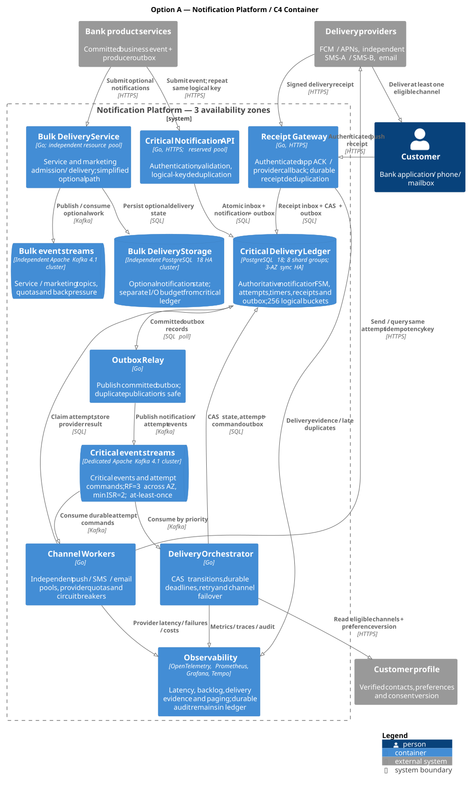
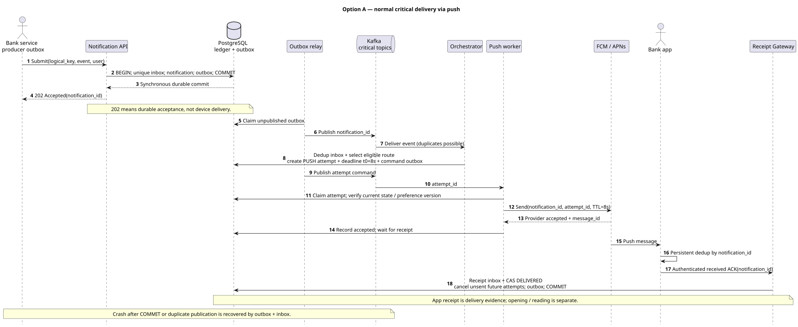
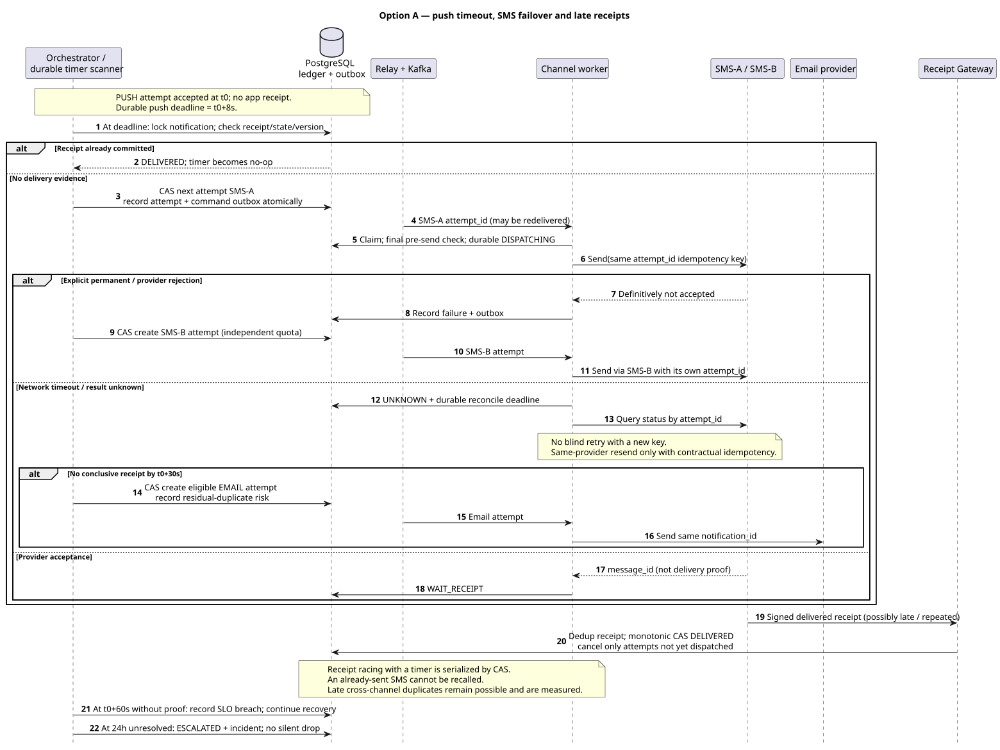
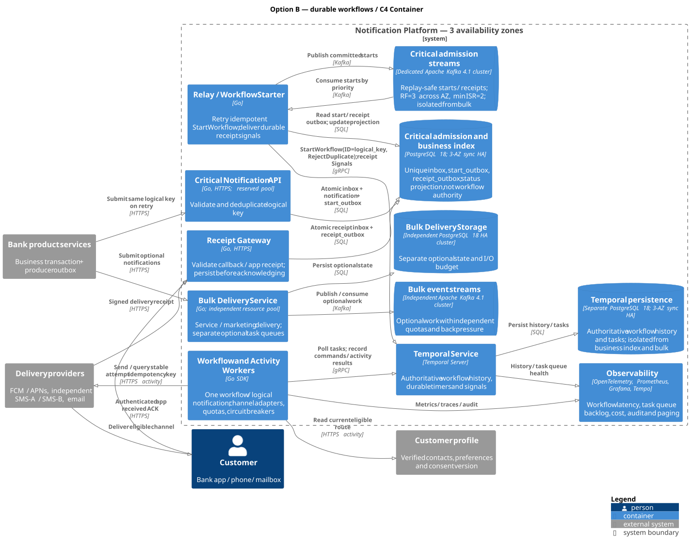
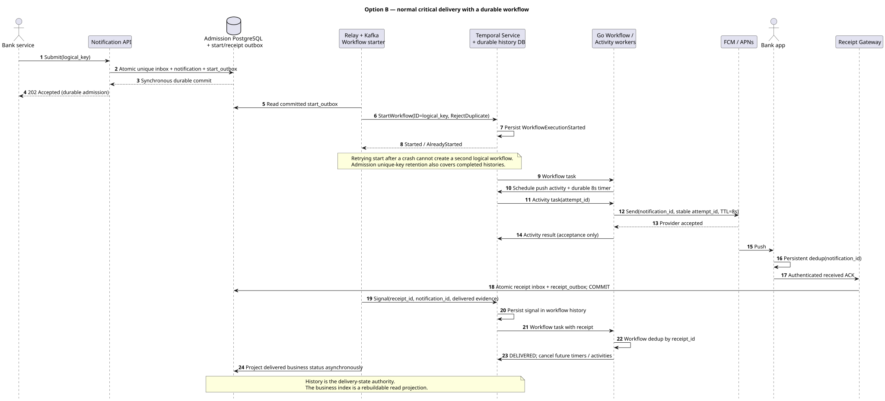
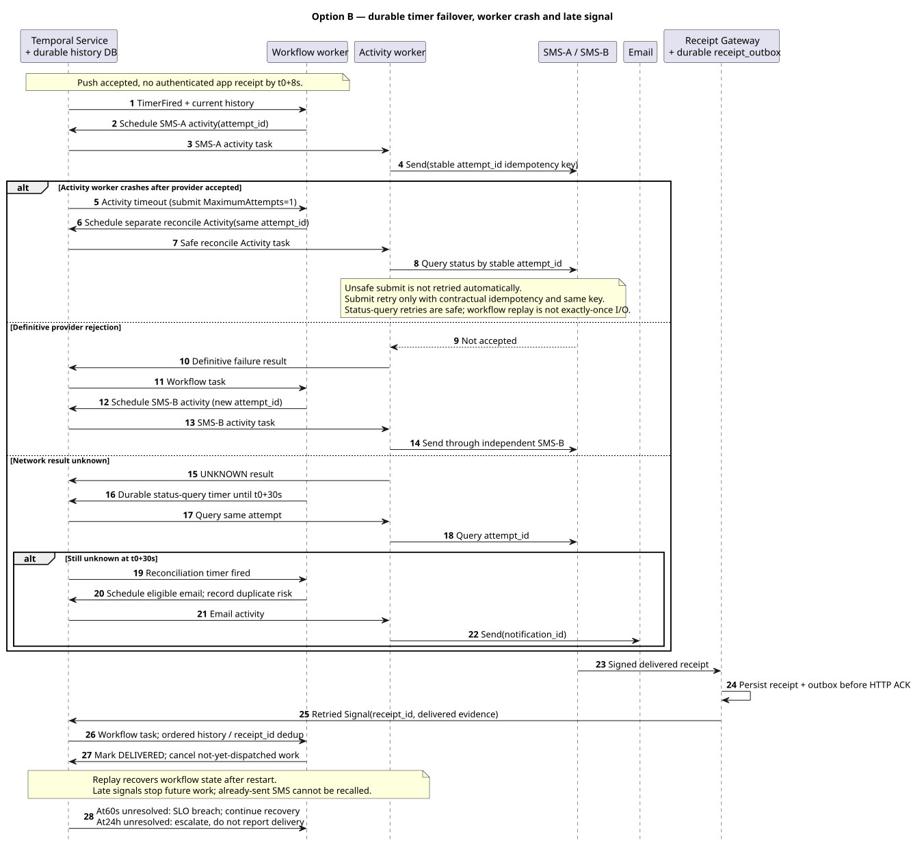

# RFC: Гарантированная доставка критичных уведомлений с автоматическим failover между каналами

| Метаданные | Значение |
|---|---|
| **Статус** | DESIGN — учебное архитектурное предложение; эксплуатационные SLO требуют проверки |
| **Автор(ы)** | Almaz Shaimerdianov (AlmazAlmaz) |
| **Ответственный** | Команда Notification Platform, роль технического владельца |
| **Бизнес-заказчик** | Владелец клиентских коммуникаций онлайн-банка, роль |
| **Ревьюеры** | Планируемые: архитектура, SRE, безопасность, мобильная команда, клиентские коммуникации; ревью не проведено |
| **Дата создания** | 2026-11-17 |
| **Дата обновления** | 2026-11-17 |

## Оглавление

1. [Контекст](#контекст)
2. [Продуктовый анализ](#продуктовый-анализ)
3. [Пользовательские сценарии](#пользовательские-сценарии)
4. [Статистика](#статистика)
5. [Требования](#требования)
6. [Варианты решения](#варианты-решения)
7. [Сравнительный анализ](#сравнительный-анализ)
8. [Выводы](#выводы)
9. [Связанные задачи](#связанные-задачи)
10. [Приложения](#приложения)

## Контекст

Команды банка самостоятельно отправляют push, SMS и email. При сбоях провайдера сообщения теряются или дублируются, нет общей истории и единой политики повторов. Для подтверждения перевода и списания это приводит к недоверию, обращениям в поддержку и риску несвоевременного обнаружения нежелательной операции.

Предлагается централизовать приём и учёт всех уведомлений, а критичный контур выделить по ресурсам. RFC детализирует именно доставку транзакционных уведомлений: устойчивое принятие, выбор канала, подтверждения, таймеры, автоматический failover и контроль повторов. Полные требования и ASR из заданий 1–7 находятся в [отдельном документе](01-requirements.md). Маркетинговая сегментация, проведение банковской операции и antifraud в границы подсистемы не входят.

### Ключевые вопросы

- **Какую проблему решаем?** Принятое критичное сообщение не должно исчезнуть при сбое процесса, AZ или провайдера; при недоступности канала должна продолжиться попытка доставки через резерв.
- **Почему сейчас?** Децентрализованная отправка уже не обеспечивает управляемого поведения, а массовая кампания на миллион получателей может вытеснить критичный трафик.
- **Кто затронут?** Клиенты, продуктовые команды, мобильные разработчики, поддержка, SRE, безопасность и владельцы договоров с провайдерами.

### Что означает «гарантированная доставка»

Безусловно гарантировать получение человеком хотя бы одного сообщения невозможно: телефон может быть выключен, адреса недействительны, а все внешние каналы недоступны одновременно. Продуктовая формулировка конкретизируется двумя контрактами:

1. **Безусловная ответственность внутри заданной модели отказов:** после durable acceptance уведомление сохранено, повторная обработка безопасна, дальнейшие действия и исход учитываются. Потеря одного процесса или одной AZ не теряет подтверждённо принятую запись. Нет скрытого удаления после исчерпания retries.
2. **Условный SLO доставки:** не менее 99,9% eligible критичных уведомлений получают подтверждение хотя бы одного канала за 60 секунд от `accepted_at`. Eligible означает, что у клиента на момент принятия есть хотя бы один проверенный и разрешённый для данного класса контакт. Отказ провайдера или выключенный телефон не исключает eligible-запись задним числом. Невозможность доставки отражается в SLO и отдельном исходе, затем обрабатывается поддержкой.

Подтверждения имеют разный смысл: push — аутентифицированный ACK банковского приложения о получении события; SMS — DLR о доставке устройству по договору с оператором; email — подтверждение приёма сервером адресата. Последнее **не доказывает попадание во входящие или прочтение**. Раздельные SLI по уровням подтверждения обязательны. Для особо чувствительного класса «только устройство» email не закрывает delivery SLO, если нет подтверждения из банковского приложения; такой класс выделяется политикой. Основной учебный класс допускает подтверждение сервера адресата, и это явный компромисс.

## Продуктовый анализ

### Цели и измерение эффекта

| Цель | Как измеряем | Связь с доставкой |
|---|---|---|
| Retention +15% относительно baseline | D30 retention когорты: цель `R_new / R_base >= 1,15`; при baseline 40% цель 46%, не 55%. Сначала 4 недели baseline, затем эксперимент с расчётом мощности | Полезные своевременные сообщения и управляемая частота; улучшение не гарантируется одной архитектурой |
| Жалобы −30% | Число обращений с категорией «уведомления» на 10 000 уникальных получателей за 28 дней: `C_new / C_base <= 0,70`; единые правила тегирования поддержки | Дедупликация, настройки, история доставки, ограничение маркетинга |
| Ответственная доставка критичных сообщений | Durable acceptance, end-to-end delivery SLI, время failover, undeliverable rate и backlog age | Защищает клиентский опыт при сбоях |

Транзакционные сообщения не отключаются и не задерживаются ради A/B-теста. Эксперимент retention использует настройки и сервисные/маркетинговые коммуникации; критичная доставка оценивается до/после и через контролируемые отказные испытания. Guardrails: рост жалоб, отписок, SMS-расходов и недоставок; при ухудшении маркетинговый эксперимент останавливается.

### Политика уведомлений и ценность

| Класс | Настройки пользователя | Политика стоимости и времени |
|---|---|---|
| Критичный: списание, подтверждение перевода, изменение средств доступа | Нельзя полностью отключить; предпочтительный канал и проверенные резервные контакты выбираются. Продуктовое правило этого проекта, не утверждение о законе | Тишина и маркетинговый budget не применяются. По умолчанию push, затем SMS, затем email; отсутствие канала не скрывается |
| Сервисный: статус заявки, напоминание | Можно отключить отдельные категории и каналы; есть тихие часы | Дешёвый разрешённый канал, без автоматического дорогого SMS по умолчанию |
| Маркетинговый: акции, кэшбэк | Только разрешённые коммуникации; полный отказ, тихие часы и общий частотный лимит | По умолчанию не более одного маркетингового уведомления в сутки; предложение, подавленное лимитом, не отправляется |

Входные 5 маркетинговых событий на активного пользователя в день — верхняя оценка **кандидатов**, до применения согласий и лимита; расчёт сохраняет этот объём как консервативную нагрузку на admission. Нельзя одновременно обещать пять доставленных маркетинговых сообщений и лимит одно в день.

При предпочтении SMS система сразу использует SMS; экономическая оптимизация не переопределяет явно выбранный допустимый канал. При выборе email клиенту показывается его более слабое подтверждение. Для класса «только устройство» email пропускается. Изменение критичного контакта требует проверки владения средствами профиля банка.

## Пользовательские сценарии

| Приоритет | Тип сценария | Действующее лицо | Сценарий |
|---|---|---|---|
| MUST HAVE | Основной | Клиент | После списания получает один логический объект уведомления; приложение подтверждает получение, резервные отправки прекращаются |
| MUST HAVE | Failover канала | Клиент | Push не подтверждён за 8 секунд; автоматически запускается SMS. Подтверждённая недоступность push запускает SMS немедленно |
| MUST HAVE | Failover провайдера | SRE/клиент | SMS-A вернул окончательный отказ до принятия: запрос идёт в SMS-B с новым provider-specific attempt; при неизвестном исходе сначала проверяется статус |
| MUST HAVE | Поздний ответ | Клиент/поддержка | Push ACK приходит одновременно с таймером SMS; фиксируется один итог, новые попытки отменяются, уже принятая внешняя SMS может дойти |
| MUST HAVE | Повтор события | Продуктовая команда | После потерянного ответа повторяет запрос с тем же логическим ключом и получает прежний `notification_id` без создания нового объекта |
| MUST HAVE | Недоступны все контакты | Поддержка | Неудача видна, уведомление остаётся в истории банка, запускается эскалация; история сама по себе не считается внешней доставкой |
| SHOULD HAVE | Настройки | Клиент | Меняет предпочтение канала; новые отправки учитывают проверенную версию настроек, маркетинговый отказ вступает в силу в пределах 5 секунд |
| COULD HAVE | Объяснимость | Поддержка | Видит причину перехода и уровень подтверждения, без доступа к полному банковскому сообщению |

## Статистика

Дано: MAU = 10 млн, DAU = 3 млн, peak concurrent users = 300 000. Основное допущение: дневные интенсивности относятся к DAU. Получается `3 млн × (2 + 3 + 5) = 30 млн` логических кандидатов в день: 6 млн транзакционных, 9 млн сервисных, 15 млн маркетинговых. Среднее `30 млн / 86 400 = 347,22/с`, критичные `69,44/с`.

| Показатель | Расчёт / результат |
|---|---|
| Burst envelope | Допущение 20× средней: `6 944,44` логических уведомлений/с |
| Плановые независимые квоты | Критичные 2 000/с, сервисные 2 500/с, маркетинг 3 500/с: всего 8 000/с |
| Кампания 1 млн | За 600 с: 1 666,67/с внутри маркетинговой квоты и дневного объёма, если не объявлена дополнительной |
| Compute N−1 | Три AZ по 4 000 логических/с, подтверждённые будущим тестом: 12 000/с всего, 8 000/с при потере одной AZ |
| Попытки критичного контура | Нормальная модель: 1,1096 попытки на сообщение; `2 000 × 1,1096 = 2 219,2/с`. Callback/status-трафик считается отдельно |
| Полный отказ push | До 2 040 SMS-запросов/с при 2% повторов; каждый из двух независимых SMS-провайдеров должен выдерживать 2 200/с |
| Чувствительность к трактовке MAU | Если 10 млн получают по 10 в день: 100 млн/день и 23 148,15/с при 20×. Текущих 8 000/с недостаточно: нужна другая квота/ёмкость |

CCU — число одновременных сессий, оно не является RPS. Например, 300 000 сессий, создающих по одному критичному событию за 150 секунд, дают 2 000/с; этот профиль требуется проверить по аналитике. Все значения выше являются входами capacity planning, а не результатом измерения работающей системы. Подробные расчёты storage, физических попыток, конкурентности, квот и стоимости находятся в [расчётном приложении](03-capacity.md); воспроизведение — `python scripts/capacity.py` из корня проекта.

Дополнительно к logical ingress нужно проверить физические запросы: модель штатного пика даёт 8 219,2 попытки/с для всех классов; целевой N−1 бюджет — 10 000 попыток/с. Независимый ACK-burst от 300 000 клиентов за10с — 30 000 receipt/с: это отдельный профиль нагрузки gateway/inbox, не покрытый предположением 8k logical/s. Для critical ledger расчёт с tombstones даёт около 2,32 TB с тремя копиями и30% запасом, без backups/WAL. Эти ресурсы проверяются совместно с N−1, а не выводятся из числа workers.

## Требования

### Функциональные требования

Ниже — срез RFC; авторитетная полная формулировка FR-01…FR-10 приведена в [заданиях 1–7](01-requirements.md). RFC сохраняет их идентификаторы и добавляет технические уточнения.

| № | Приоритет | Обозначение | Требование в контексте RFC |
|---|---|---|---|
| 1 | MUST HAVE | FR-01 | Единый приём критичных сообщений от продуктовых команд с доступным статусом |
| 2 | MUST HAVE | FR-02 | Приоритет критичных сообщений перед сервисными и маркетинговыми |
| 3 | MUST HAVE | FR-03 | Автоматический переход между каналами/провайдерами по единой политике |
| 4 | MUST HAVE | FR-04 | Один логический объект на банковское событие, получателя и тип; подавление управляемых повторов |
| 5 | MUST HAVE | FR-05, FR-06 | Соблюдение настроек, допустимых обязательных уведомлений, согласий и каналов |
| 6 | MUST HAVE | FR-07 | Тихие часы и общие ограничения частоты некритичных сообщений |
| 7 | MUST HAVE | FR-08 | Запуск кампании до 1 млн получателей, просмотр хода и остановка оставшихся отправок; изоляция critical обеспечивается также FR-02 |
| 8 | MUST HAVE | FR-09 | Поддержке доступен объяснимый ход доставки и эскалация |
| 9 | SHOULD HAVE | FR-10 | Выбирать наиболее дешёвый допустимый путь при соблюдении срочности и предпочтений |

### Нефункциональные требования

| № | Приоритет | Обозначение | Измеримый контракт |
|---|---|---|---|
| 1 | MUST HAVE | NFR-01 | От durable acceptance до первой передачи провайдеру p99 ≤ 1 с; push ACK приложения p95 ≤ 2 с в когорте доступных клиентов |
| 2 | MUST HAVE | NFR-02 | ≥99,9% eligible critical с допустимым подтверждением ≤60 с за месяц; полный eligible-знаменатель сохраняется при авариях |
| 3 | MUST HAVE | NFR-03 | RPO = 0 для принятого при потере одной AZ; RTO ≤5 мин в отказном испытании. Потеря региона — отдельная модель |
| 4 | MUST HAVE | NFR-04 | Доступность приёма ≥99,95% за календарный месяц; каждый принятый critical имеет статус, историю и ответственного до закрытия |
| 5 | MUST HAVE | NFR-05 | Логический unique key; ноль повторных side effects в тестах с идемпотентным провайдером; остаточные физические cross-channel дубли измеряются |
| 6 | MUST HAVE | NFR-06 | 30 мин нагрузки 8 000 logical/s, включая 2 000 critical/s и кампанию 1 млн/600 с; отдельно физические попытки и N−1 |
| 7 | MUST HAVE | NFR-07 | Изменения настроек применяются ≤5 с; 100% запусков фиксируют версию policy/preferences |
| 8 | MUST HAVE | NFR-08 | 100% critical lifecycle в durable audit; сигнал ≤60 с после превышения определённого порога, метрики и распределённые трассы |
| 9 | MUST HAVE | NFR-09 | Внешние соединения защищены; содержимое и контакты закрыты по ролям; в logs/metrics нет открытых PII; задан срок хранения |
| 10 | SHOULD HAVE | NFR-10 | SMS ≤10% critical за здоровое 7-дневное окно как экономический ориентир; критичная доставка не блокируется при перерасходе |

Availability SLI приёма: успешные авторизованные валидные requests / все авторизованные валидные requests, включая ответы 5xx и capacity-429 как неуспешные. Повторы считаются запросами для availability, но не новыми уведомлениями для delivery. Бюджет — 0,05% валидных запросов; для месяца 30 дней это эквивалентно 21,6 минуты полного отказа только при равномерном трафике. Для 180 млн critical/30 дней бюджет delivery misses при 99,9% — 180 000, поэтому дополнительно контролируется per-minute burn rate: месячный агрегат не оправдывает продолжительный массовый сбой.

RTO 5 минут может нарушить delivery ≤60 секунд; это не исключается из знаменателя. В 5-минутный перерыв при средней критичной интенсивности образуются около 20 833 сообщения. Поэтому ≤5 минут — предельный recovery objective, а не обещание удержать SLO для каждого запроса. SLO p95 и p99 — проектные цели, не юридический SLA с уже заключённым договором.

### Архитектурно значимые требования

| ASR / приоритет | Источник | Архитектурные последствия |
|---|---|---|
| ASR-01 / P0: задержка | FR-01/02; NFR-01/02 | Независимый critical pipeline, короткий durable admission, квоты, warm workers, ограниченные таймеры |
| ASR-02 / P0: сохранность и failover | FR-02/03/09; NFR-03/04 | Source outbox, ledger, outbox, persistent timers, независимые провайдеры, 3 AZ, reconciliation |
| ASR-03 / P0: идемпотентность и гонки | FR-04; NFR-05 | Стабильные logical/attempt keys, unique constraints, CAS/fencing, monotonic terminal state, дедупликация callback |
| ASR-04 / P1: масштаб и изоляция | FR-02/08; NFR-02/06 | Раздельные topics/pools/квоты и storage critical, backpressure, sharding и capacity N−1 |
| ASR-05 / P0: настройки, безопасность, аудит | FR-05/06/07/09; NFR-07/08/09 | Policy versions, проверенные контакты, RBAC, шифрование, durable journal и наблюдаемость |
| ASR-06 / P1: стоимость | FR-03/10; NFR-10 | Предпочтение дешёвого канала по умолчанию, ожидание ACK 8 с, cost ledger и аварийный резерв SMS |

P0 — блокирует запуск; P1 — необходим для целевой нагрузки/экономики, при деградации его ограничение не отменяет критичную доставку. Детальные архитектурные вопросы и непригодные решения — в разделах 4–6 [требований](01-requirements.md).

## Варианты решения

### Общий контракт интеграции

Источник сохраняет бизнес-операцию и событие в своём **transactional outbox в одной локальной транзакции**. Отправитель повторяет запрос до принятия платформой. Простая отправка HTTP после коммита операции оставляет окно потери до Notification API; без producer outbox гарантия начинается только с приёма платформой, а не с операции банка.

`POST /v1/notifications` принимает `event_id`, `recipient_ref`, `type`, `template_id`, `payload_ref`, `occurred_at`, `expires_at`, `policy_version`. Контакты извлекаются из проверенного профиля, произвольный номер от продуктового сервиса не разрешён. mTLS и scope продукта ограничивают типы шаблонов.

`logical_key = HMAC(tenant_id | event_id | recipient_ref | notification_type)`; версия шаблона не входит в ключ, чтобы её изменение не создало дубль. Для нового легитимного события коррекции нужен новый `event_id`. Разделители/каноническое кодирование обязательны. Одинаковый ключ с другим каноническим payload hash возвращает `409`, а не молча меняет первоначальное сообщение.

Сначала выполняется lookup существующего logical key: повтор возвращает прежний ID даже за пределами обычного replay-окна, пока сохранён tombstone. Новые входящие события старше 7 дней направляются на отдельную сверку, а не на автоматическую повторную отправку. Tombstone хранится 90 дней, поэтому обычное replay-окно короче окна дедупликации; после его истечения нельзя просто повторить исторические события. Ротация HMAC-ключа использует версионированный lookup старого ключа на всём dedup-окне, чтобы тот же event не попал в другой bucket и не стал новым уведомлением.

Новый запрос возвращает `202 {notification_id, status: ACCEPTED}` только после устойчивой записи; повтор — тот же ID и текущий статус. Ошибка/timeout клиента требует повтора с тем же ключом. `GET /v1/notifications/{id}` возвращает итог, причину, попытки и уровень подтверждения. `DELIVERED` не означает `READ`.

Receipt API проверяет подпись провайдера/mTLS, timestamp, replay window и соответствие provider message ID попытке; callback подтверждается HTTP 2xx только после durable сохранения. Push ACK аутентифицирован приложением, привязан к получателю и `notification_id`, не принимается по одному знанию UUID.

### Общая политика failover и конечный автомат

| Событие / время от accepted_at | Действие | Что считается успехом |
|---|---|---|
| t≈0, есть разрешённый push | Одна попытка push. При недоступности токена канал сразу пропустить | ACK приложения, не HTTP 200 от FCM/APNs |
| t≤8 с | Ждать ACK; при окончательном отказе перейти раньше. Для известного offline не тратить все 8 с | Первый допустимый receipt завершает доставку |
| t=8 с, push неизвестен | Зафиксировать timeout и переход, отправить SMS-A; push TTL = 8 с как снижение поздней доставки, не обещание её отсутствия | DLR согласно контракту SMS |
| SMS-A явно отверг до принятия | Немедленно SMS-B при доступной квоте | Новый provider-specific ID, связь с той же notification |
| SMS timeout/потеря HTTP-ответа | Состояние UNKNOWN; запрос статуса по клиентскому attempt ID, повтор только с тем же idempotency key при поддержке провайдера | Нельзя считать неизвестность отказом и слепо повторять SMS |
| t=30 с, нет подтверждения | При definitive failure выбрать SMS-B; при UNKNOWN SMS — email или следующий допустимый канал с фиксацией duplicate risk | Email server acceptance допустим только для основного класса; device-only продолжает поиск device receipt |
| t=60 с | Зафиксировать SLO breach, уведомить дежурного/поддержку, продолжать восстановление | Таймер SLO не равен терминальному удалению |
| До 24 ч | Ограниченные ретраи доступных каналов, backoff + jitter, проверка актуальности по типу. Истёкшее сообщение не показывать как свежее | После 24 ч автоматический поиск закрывается как ESCALATED_UNDELIVERED; ответственный тикет остаётся открытым |

Ожидание и порядок применяются к оставшимся каналам после пользовательского предпочтения: для SMS-first не создаётся лишняя push-попытка. Недоступный/запрещённый контакт пропускается; обязательность critical не позволяет игнорировать отсутствие подтверждённого контакта. При отсутствии всех контактов сразу эскалация с `NO_REACHABLE_CONTACT` и in-app записью.

HTTP submit timeout = 1 секунда, status query timeout = 1 секунда; один безопасный транспортный retry с jitter 100–300 мс внутри бюджета. Для длительного восстановления интервалы 30 с, 2 мин, 10 мин, затем 30 мин до deadline. Постоянные ошибки invalid address/token не повторяются. Это стартовые значения для проверки, а не характеристики внешних поставщиков.

Состояния notification: `ACCEPTED → DELIVERING → DELIVERED` либо `ESCALATED_UNDELIVERED`; `SLO_BREACHED` — отдельный флаг времени, не состояние, блокирующее доставку. Попытка: `PLANNED → SUBMITTING → ACCEPTED_BY_PROVIDER → CONFIRMED`, либо `DEFINITIVE_FAILED` / `UNKNOWN`. Поздний receipt после эскалации записывается в аудит как `LATE_CONFIRMED`, уточняет фактический исход, но не стирает факт нарушения deadline/SLO. Delivered монотонен; поздний failure его не отменяет.

Circuit breaker отдельно на провайдера и метод submit/status: при ≥20 запросах за последние 10 с и доле временных ошибок >50% открывается на 30 с, затем ограниченный half-open probe. Локальные лимиты/перегрузка не должны выглядеть как отказ всех провайдеров. Rate limiter учитывает общую договорную квоту всех инстансов; при недоступности общего limiter используется консервативная квота на worker, marketing приостанавливается.

### Вариант 1: Kafka + PostgreSQL + собственный автомат доставки

**Описание:** PostgreSQL хранит авторитетное состояние доставки, Kafka переносит задания как минимум один раз. Go-сервисы реализуют небольшой версионируемый конечный автомат; due-time scheduler читает устойчивые таймеры. Существование Kafka не заменяет timer/ledger.

#### Архитектура

[PlantUML C4](../diagrams/a-container.puml).

| Контейнер / технология | Ответственность |
|---|---|
| Notification API / Go | Авторизация, проверка ключа, admission, атомарная запись notification + outbox; ACK после commit |
| Ledger / PostgreSQL 18 + Patroni + etcd | Notification, attempt, unique keys, receipts, next_action_at, outbox, journal; авторитетное состояние |
| Outbox relay / Go | Выборка неподтверждённых записей, публикация Kafka, отметка после broker ACK; возможны повторные публикации |
| Broker / Apache Kafka 4.1 | Отдельный critical cluster/topic от bulk-кластера service/marketing; RF=3 по AZ, min.insync.replicas=2, acks=all, idempotent producer, unclean leader election выключен |
| Orchestrator + scheduler / Go | Policy, CAS переходы, выдача попыток, таймеры, reconciliation неизвестных исходов |
| Channel workers / Go | Изолированные push/SMS/email pools, quotas, provider idempotency, нормализация ошибок |
| Receipt Gateway / Go | Durable callback inbox, проверка подлинности, привязка receipt к попытке |
| Наблюдаемость / OpenTelemetry, Prometheus, Grafana, Tempo | Метрики, трассы и поиск инцидентов; durable audit находится в ledger, не в sampled traces |
| Архив / S3-совместимое объектное хранилище | Зашифрованный аудит, backup/WAL и контролируемая retention |

Redis может ускорять чтение справочников, но не является авторитетным хранилищем дедупликации или таймеров. Preference/Contact Service — существующая зависимость банка. Устаревший порядок предпочтений допустимо заменить аварийной политикой, однако свежесть разрешения и действительности контакта должна подтверждаться в пределах 5 секунд: недоступность сервиса не разрешает отправлять на потенциально отозванный номер. При невозможности проверить канал optional отправки приостанавливаются; critical используют другой независимо проверенный канал либо остаются durable pending с возможным нарушением SLO и эскалацией. В критичном теле нет чувствительных реквизитов; fallback на отозванный контакт запрещён.

##### Основной сценарий

[Sequence PlantUML](../diagrams/a-normal.puml).

1. После source outbox API одной транзакцией создаёт notification, журнал принятия и outbox; unique key подавляет повтор. Клиент получает ACK после синхронно устойчивого commit.
2. Relay публикует `NotificationAccepted`; orchestrator под row lock/CAS фиксирует policy snapshot, attempt и outbox задания каналу. Offset потребителя подтверждается после коммита. Повтор Kafka не создаёт новую попытку из-за уникальности `(notification_id, attempt_no)` и записанного event ID.
3. Worker перед внешним вызовом атомарно захватывает попытку, проверяет актуальную версию и отсутствие итогового receipt. Сетевой вызов выполняется **вне долгой DB-транзакции**. Использует стабильный attempt idempotency key.
4. Receipt Gateway сохраняет inbox и связанное событие; orchestrator под блокировкой фиксирует `DELIVERED`, отменяет ещё не начатые попытки и таймеры. Изменения попадают в durable journal.

##### Failover-сценарий

[Sequence PlantUML](../diagrams/a-failover.puml).

Scheduler каждые 100 мс выбирает пачку due rows через `FOR UPDATE SKIP LOCKED`, затем в короткой транзакции фиксирует переход и outbox. `next_action_at` индексируется по shard/state; process-local `sleep` не является таймером доставки. После падения scheduler другая реплика находит те же due actions. PostgreSQL поддерживает row locks; конкретная схема очереди и CAS являются предложением данного RFC. [Документация PostgreSQL](https://www.postgresql.org/docs/18/explicit-locking.html).

##### Согласованность и защита от дублей

| Окно отказа / гонка | Механизм | Остаточное ограничение |
|---|---|---|
| API commit выполнен, HTTP-ответ потерян | Stable logical key, прежний ID и payload hash | Дедупликация действует в объявленном retention/replay window |
| Relay опубликовал Kafka, упал до отметки | At-least-once + inbox unique event_id | Broker dedup не заменяет consumer dedup |
| Receipt и таймер SMS приходят одновременно | Row lock либо CAS `version=v AND status<>DELIVERED`; outbox создаётся в той же транзакции | Если SMS уже ушла, её отмена не гарантируется |
| Worker отправил SMS, упал до записи результата | SUBMITTING → UNKNOWN; status query, безопасный повтор с прежним ключом | Без provider idempotency/status доказать отсутствие SMS невозможно |
| Lease worker истёк, старый процесс ожил | Fencing token в DB и проверка перед submit; provider key остаётся прежним | Провайдер не проверяет DB fencing: защита последнего сетевого окна зависит от его idempotency |
| Повтор callback / reordered events | Unique `(provider, provider_event_id)` и монотонность receipt | Доставка и read не объединяются в один статус |
| Push дошёл после перехода на SMS | Общий notification_id в приложении, TTL, проверка server state перед показом при доступной сети | Физический дубль между SMS и push полностью исключить нельзя |

Kafka exactly-once внутри потоковой обработки не делает внешний SMS/email side effect exactly-once. Внешнее действие требует кооперации провайдера; проект применяет at-least-once обработку и идемпотентность там, где она доступна. [Официальное описание delivery semantics Kafka](https://kafka.apache.org/41/design/design/).

##### Данные и масштабирование

`notification(id, logical_key, payload_hash, policy_version, preference_version, accepted_at, deadline_at, status, version, next_action_at, slo_breached_at)`; `attempt(id, notification_id, ordinal, channel, provider, provider_key, state, receipt_level, lease_epoch)`; `receipt_inbox`; `outbox`; `delivery_journal`. Тела сообщений/контакты — зашифрованные ссылки, минимум необходимого в broker. Индекс статуса для поддержки обновляется асинхронно, SLA поиска отделён от доставки.

Critical и bulk имеют независимые PG-кластеры, pools и I/O budgets: одних topics недостаточно для изоляции. Для critical планируются 256 логических hash buckets по logical key, распределённых на 8 физических PG shard-групп с тремя AZ-копиями каждая; это начальная конфигурация для тестирования. Все таблицы одного уведомления размещаются на одном shard, межшардовая транзакция не нужна. Количество физических shard уточняется тестом; journal/date partitions и ограничение размеров индексов предотвращают одну таблицу на миллиарды горячих строк. Rebalance bucket выполняется через routing version и остановку writers конкретного bucket; dual-active writers не допускаются.

У каждого PG-shard один primary и две standby по AZ; `synchronous_commit=on`, `synchronous_standby_names='ANY 1 (...)'`, ACK после local WAL flush и remote flush хотя бы в другой AZ. Patroni использует strict synchronous mode и promotion только узла с подтверждённым WAL; etcd quorum/fencing не допускает split brain. При потере нужного кворума записи не подтверждаются. Синхронная репликация увеличивает задержку и может ограничить доступность — цена RPO=0. При несогласованной promotion-политике одного параметра PostgreSQL недостаточно. [Документация синхронной репликации](https://www.postgresql.org/docs/current/warm-standby.html#SYNCHRONOUS-REPLICATION).

При отказе Kafka acceptance может продолжаться в ограниченный durable outbox до high watermark; delivery SLO при этом может нарушаться. При достижении 10 минут backlog age либо 70% дискового лимита включается admission backpressure, HTTP 503 не считается принятым, source outbox хранит событие. Marketing останавливается раньше. Потеря одной AZ не должна ждать HPA: резерв workers и provider quotas уже выделен.

##### Выполнение ASR

| ASR | Механизм варианта 1 | Как проверяется / ограничение |
|---|---|---|
| ASR-01 | Independent critical path, batching relay ≤50 мс, scheduler100 мс, warm workers | E2E histogram от accepted_at; p99≤1 с на целевой нагрузке должен доказать тест |
| ASR-02 | Source outbox + ledger/outbox + 3AZ + reconciliation + channel/provider failover | Kill process/AZ, broker outage, replay; внешний all-down не превращается в ложный успех |
| ASR-03 | Unique keys, row locks/CAS, receipts inbox, provider key | Race/unknown-outcome tests; physical cross-channel exactly-once недостижим |
| ASR-04 | Critical/bulk storage и broker раздельны, quotas, 256 buckets/8 shard-групп, N−1 compute | 8k logical/s 30 мин + AZ failure; число shards — гипотеза до benchmark |
| ASR-05 | Versioned policy, secure contact refs, durable journal, traces/metrics | Consent-change race, callback forgery/replay, audit completeness |
| ASR-06 | Push-first 8с по умолчанию, SMS budgets/ledger и provider routing | Измерение SMS-share и cost per confirmed; preference SMS-first повышает расходы |

#### Этапы реализации

Оценка для команды 3 backend + 1 SRE + QA 0,5 ставки + mobile 0,5 ставки; сроки ориентировочные, не факт выполненной реализации.

| Этап | Описание | Планируемый срок | Ресурсы | Риски |
|---|---|---|---|---|
| 1 | Контракты, producer outbox, state model, стенд provider simulator | Недели 1–2 | 2 backend, SRE/QA | Реальные providers не имеют status/idempotency |
| 2 | API/ledger/outbox/Kafka, push и receipts | Недели 3–4 | 3 backend, mobile | Push ACK недоступен для части устройств |
| 3 | SMS/email, timers, races, observability и runbook | Недели 5–6 | 3 backend, SRE, QA | Неправильная классификация UNKNOWN |
| 4 | Capacity/N−1/chaos, security review, пилот и расширение | Недели 7–8 | Вся команда | Недостаточные квоты или DB IOPS; выпуск откладывается |

#### Преимущества

- Простой конечный набор каналов, полный контроль hot path, batching и модели данных; нет дополнительного workflow runtime.
- Локальная атомарность ключевых переходов в ledger; операционная команда видит явное состояние и durable timers.
- При допущении существующих компетенций Kafka/PostgreSQL внедрение укладывается в уже знакомый стек.

#### Недостатки

- Собственная реализация scheduler, leases, FSM migrations, reconcilers и инструментов разборов — значительный объём ответственной логики.
- Шардированный PostgreSQL требует отдельной эксплуатации; state machine не становится корректной автоматически от наличия Kafka.
- Ошибки таймеров/CAS могут давать потерянные действия; до запуска нужны отказные проверки, а не только happy path.

### Вариант 2: Temporal durable workflows

**Описание:** на каждое критичное сообщение запускается отдельный workflow. Temporal сохраняет историю, таймеры и порядок команд; Go Activities обращаются к внешним каналам. Это альтернативный способ оркестрации, а не другая политика доставки.

#### Архитектура

[PlantUML C4](../diagrams/b-container.puml).

| Контейнер / технология | Ответственность |
|---|---|
| Notification API / Go + PostgreSQL 18 | Durable admission inbox, logical-key tombstones, start_outbox; business status — асинхронная проекция |
| Starter/Receipt relay / Go + Kafka 4.1 | Kafka переносит события source/start/receipt; starter повторяет StartWorkflow до результата; receipt relay повторяет Signal |
| Temporal Server self-hosted / production stable release, зафиксированная при PoC | Frontend/history/matching, durable workflow timers, task queues; развёртывание в 3 AZ |
| Temporal persistence / отдельный PostgreSQL 18 HA | Авторитетная история workflow; отдельна от business index и bulk storage |
| Workflow workers / Temporal Go SDK | Детерминированная политика, select receipt/timer, versioning workflow |
| Activity workers / Go | Push/SMS/email calls, provider idempotency/status; отдельные task queues и лимиты |
| Receipt Gateway / Go + PostgreSQL inbox | Durable приём callback, аутентификация, доставка Signal нужному workflow |
| OpenTelemetry / Prometheus / Grafana / Tempo | Workflow age, task schedule-to-start, activity retries, стоимость и SLO |

Temporal и SDK выбираются как совместимые production releases и фиксируются digest на этапе PoC; придуманную точную версию документ не задаёт. Это конкретный продукт, broker и СУБД, а не выбор между абстрактными движками. [Temporal описывает восстановление workflow через durable execution](https://docs.temporal.io/workflow-execution).

##### Основной сценарий

[Sequence PlantUML](../diagrams/b-normal.puml).

API фиксирует acceptance и start_outbox атомарно. Starter вызывает `StartWorkflow` с `WorkflowID = logical_key`, `WorkflowIDReusePolicy = RejectDuplicate`, conflict policy без запуска второго running workflow. ACK API не ждёт Temporal: потеря Temporal временно увеличивает start backlog, который восстанавливается relay. Окно «DB commit прошёл, workflow не запустился» закрывает outbox; сетевой ответ StartWorkflow не является единственным доказательством запуска.

Дедупликация после удаления workflow history обеспечивается PG tombstone с тем же сроком replay, а не одной лишь uniqueness активного WorkflowID. Продуктовые повторные запросы сначала проходят business admission. Внутри workflow хранится авторитетное состояние доставки; PG status index — projection, **не второй конкурирующий FSM**. [Политики WorkflowID](https://docs.temporal.io/workflow-execution/workflowid-runid).

Workflow выбирает канал, вызывает Activity с фиксированным attempt ID и ждёт Signal receipt либо durable timer. Применяется тот же 8-секундный бюджет push. Receipt Gateway сначала сохраняет callback, затем relay отправляет Signal; до подтверждения Temporal outbox не очищается. Повтор Signal дедуплицируется по provider_event_id в workflow. Если callback пришёл раньше StartWorkflow, он ждёт в durable outbox, а не теряется на `NotFound`.

##### Failover-сценарий

[Sequence PlantUML](../diagrams/b-failover.puml).

После timer workflow запускает следующую Activity. Падение worker восстанавливается replay без повторного выполнения уже записанных решений. Однако внешний вызов, выполненный до потери результата Activity, может повториться. Поэтому у Activities те же стабильные provider keys и UNKNOWN/status query, что у варианта 1; нельзя включить безусловные retries отправки SMS.

Для send Activity: StartToClose 2 с, общий ScheduleToClose 5 с, MaximumAttempts=1 для небезопасного submit. Отдельная reconcile Activity с безопасным status query имеет exponential backoff; retry submit разрешается только при договорной idempotency с прежним ключом. Timers не занимают sleeping worker. Отмена Activity/таймера запрещает будущую работу, но не отзывает уже доставленную SMS. [Жизненный цикл Activities и отмена](https://docs.temporal.io/activity-execution).

Task queues critical/push/SMS/email отделены от bulk; concurrency limits и quota limiter не дают масштабированию workers превысить провайдерские контракты. При 6 млн critical/день одна только история workflow объёмна: если 25 events × 1 KB, то 150 GB/день логически, 3 дня hot = 450 GB и около 1,35 TB при трёх копиях до индексов/WAL. Это отдельная предварительная оценка, дополнительно к business index и broker; actual event bytes нужно снять на PoC. При 2k starts/s получается около 50k history events/s с той же моделью, поддержка этого rate конкретным Temporal persistence не предполагается доказанной.

Предполагается 24h workflow deadline и short history, затем archival; tombstones живут 90 дней. После восстановления длительного сбоя workflow не бесконечно воспроизводят устаревший контент. Изменение кода использует Worker Versioning/совместимые workflow branches; недетерминированный replay является блокирующим риском выпуска. Temporal persistence HA имеет те же требования RPO/promotion, что ledger варианта 1. Включение async geo replication не создаёт RPO=0 для региона.

##### Выполнение ASR

| ASR | Механизм варианта 2 | Как проверяется / ограничение |
|---|---|---|
| ASR-01 | Warm workflow/activity workers, независимые queues, малый schedule-to-start | Дополнительные transitions/history writes: p99 ≤1с доказывается PoC, не свойство по умолчанию |
| ASR-02 | Admission outbox + durable workflow timers/history + receipt outbox | Kill worker/server, restart и replay; квоты и all-channels-down остаются внешним ограничением |
| ASR-03 | Logical key, WorkflowID policy, business tombstones, signal dedup, provider keys | Activity timeout не равен отсутствию side effect; сохранены residual duplicates |
| ASR-04 | Горизонтальные workers и history shards, отдельные persistence/task queues | 2k starts/s и около50k history events/s требуют benchmark и capacity, возможна стоимость persistence |
| ASR-05 | Версионирование policy в workflow, payload encryption codec, RBAC, audit export | Нельзя помещать PII в WorkflowID/Search Attributes; аудит полноты отделён от sampled traces |
| ASR-06 | Тот же policy и дешёвый primary, cost events из Activities | Стоимость orchestration/retention выше; cost comparison требует реальных тарифов/ресурсов |

#### Этапы реализации

Оценка для 3 backend + 1 SRE + QA 0,5 + mobile 0,5; при отсутствии опыта Temporal добавлены обучение и эксплуатационные проверки.

| Этап | Описание | Планируемый срок | Ресурсы | Риски |
|---|---|---|---|---|
| 1 | Temporal PoC, HA/persistence, admission/start/receipt outbox | Недели 1–3 | 2 backend, SRE | Нет компетенции, 2k workflow starts/s не достигнуты |
| 2 | Workflow/Activities, push ACK, timers, policies | Недели 4–5 | 3 backend, mobile | Недетерминированность, повтор Activity side effect |
| 3 | SMS/email/status reconciliation, versioning, audit | Недели 6–7 | 3 backend, QA, SRE | Retention и replay после обновлений |
| 4 | Capacity/chaos/security, пилот и миграция | Недели 8–10 | Вся команда | Слабая наблюдаемость runtime или дорогой persistence |

#### Преимущества

- Устойчивые таймеры и восстановление последовательности уже предоставляет workflow engine; меньше собственной scheduler/lease логики.
- История решений облегчает разбор сложных долгоживущих процессов и изменение многошаговой политики.
- Разделение Activities/оркестрации удобно для будущих процессов с большим количеством зависимых шагов.

#### Недостатки

- Дополнительная stateful-платформа, компетенции эксплуатации, workflow versioning, история и I/O на каждый переход.
- Temporal не решает идемпотентность внешнего провайдера и не избавляет от admission/receipt outbox.
- Низкая задержка и пиковая скорость workflow start должны проверяться; на простой трёхканальной цепочке выигрыш сложности не очевиден.

## Сравнительный анализ

### Ресурсные требования

| Критерий | Вариант 1 | Вариант 2 |
|---|---|---|
| Время реализации | 8 недель, оценка | 10 недель, оценка при новой компетенции |
| Команда | 3 backend + 1 SRE + 0,5 QA + 0,5 mobile | Аналогичная команда, SRE обучается Temporal; оценка может измениться |
| Инфраструктура | Critical/bulk Kafka, PG ledger shards, stateless workers, observability | Kafka интеграции + PG admission + Temporal servers и отдельный persistence + workers |
| Основной CPU/I/O риск | Timers scan, WAL/indexes, hot shards | History writes, workflow start, task schedule-to-start, replay |
| Сложность приложения | Выше: собственные timers/leases/FSM | Ниже для оркестрации, остаются provider ambiguity и outbox |
| Сложность эксплуатации | Уже знакомые Kafka/PostgreSQL по допущению | Дополнительный runtime, schema upgrades, history retention/versioning |
| Организационные риски | Ошибка собственного автомата, bus factor | Новая платформа, зависимость от компетенций Temporal |

Денежный TCO не заявлен числом без тарифов инфраструктуры и стоимости команды. Сравниваются явные компоненты, event volume и сроки как гипотезы; стоимость доставки одинакова при одной policy. Синтетический SMS cost model вынесен в расчёты и не является коммерческим предложением.

### Соответствие требованиям

«Предусмотрено» означает наличие механизма в проекте; это не означает пройденный production benchmark.

| Требование | Вариант 1 | Вариант 2 |
|---|---|---|
| FR-01/02: приём и приоритет | Ledger/outbox, изолированный critical pipeline | Admission/start_outbox, независимые critical queues |
| FR-03: failover | Persisted policy/timers, retries/reconcile | Durable timers/Activities/reconcile |
| FR-04: логическая дедупликация | Unique ledger + CAS | PG logical key + WorkflowID + provider keys |
| FR-05/06: настройки/обязательные классы | Policy/preference snapshot + pre-send check | Snapshot в workflow + Activity check |
| FR-07/08: частота и кампании | Общий budget optional, campaign progress и stop ≤5с | Optional admission budget, campaign progress и stop ≤5с |
| FR-09: статус/поддержка | Journal и projection | Workflow history + journal projection |
| FR-10/NFR-10: стоимость | Предусмотрено; SMS-share зависит от клиентов | Аналогично; добавляется runtime cost |
| NFR-01/02: latency/delivery SLO | Проектно предусмотрено; нагрузочные проверки обязательны | Аналогично; дополнительно schedule-to-start/history writes |
| NFR-03/04: RPO/availability | Sync HA, strict promotion, source outbox | Sync persistence/admission HA и outbox |
| NFR-05: дедупликация | Управляемые дубли подавляются; cross-channel физические возможны | То же; replay не обеспечивает внешнее exactly-once |
| NFR-06: нагрузка | Требуется подтвердить 8k logical/s и N−1 | Требуется подтвердить также около50k history events/s |
| NFR-07/08/09: настройки/audit/security | Версии, durable journal, secure refs | Версии, durable history/export, encrypted payloads |

### Ключевые компромиссы

| Компромисс | Принятое решение | Цена |
|---|---|---|
| Быстрее fallback ↔ дешевле и меньше дублей | 8 секунд на push ACK, затем SMS | Часть медленных push породит дорогую SMS; более долгое ожидание уменьшило бы расходы, ухудшив задержку |
| Exactly-once ↔ eventual delivery при UNKNOWN | Не слать повтор слепо; status query, затем другой допустимый канал с меткой risk | При некооперативном провайдере одновременно обеспечить отсутствие физических дублей и своевременную доставку невозможно |
| Сохранность ↔ доступность/latency | Sync cross-AZ ACK, fencing, fail closed при отсутствии кворума | Часть приёма временно недоступна; событие сохраняет source outbox |
| Изоляция ↔ эксплуатационные расходы | Critical имеет отдельные broker/DB/pools | Дублирование минимального HA footprint оправдано критичностью |
| Предпочтение клиента ↔ стоимость | Явный допустимый SMS-first выше push-first оптимизации | SMS-share 10% — ориентир, не гарантированный верхний лимит |
| Device receipt ↔ широта fallback | Основной класс допускает email server receipt; sensitive-class требует device receipt | Для sensitive-класса email не закрывает SLO, доля подтверждений ниже |
| Простота продукта ↔ runtime complexity | Для трёх каналов выбран свой небольшой FSM | Команда отвечает за его correctness; при росте сложности Temporal становится привлекательнее |

### Отказы, наблюдаемость и эксплуатация для обоих вариантов

| Ситуация | Реакция |
|---|---|
| Потерян consumer/worker | Replay/redelivery, persisted state, provider idempotency; UNKNOWN reconcile вместо новой безусловной отправки |
| Потеря AZ | Заранее выделенный N−1 reserve, quorum promotion/fencing; потеря региона сюда не входит |
| Push mass outage | Circuit breaker, SMS квоты 2× независимых провайдеров, emergency budget; 10% SMS-target не блокирует |
| SMS-A timeout | Не считать отказом; статус по client reference, затем политика UNKNOWN. Независимость SMS-B проверяется, общий upstream возможен |
| Все каналы недоступны | Сохранить состояние, SLO breach, incident и поддержка, retries до deadline; in-app inbox не выдаётся за внешнюю доставку |
| Изменились настройки | Optional перед submit перепроверяет версию; revoke блокирует новые attempts. Уже переданное провайдеру не отзывается гарантированно |
| Повреждённое событие | Quarantine/DLQ + alert и владелец; critical DLQ не terminal success, исправление с прежним logical key |
| Backlog после восстановления | Приоритет новым critical и ограниченный recovery budget для старых, fair scheduling по возрасту; согласованные квоты нельзя превышать |

SLI: `accepted_total`, `confirmed_within_60s / eligible_accepted`, `unconfirmed_age`, `first_handoff_latency`, `push_ack_latency`, `failover_total{reason}`, `unknown_attempts`, `outbox_oldest_age`, `timer_lateness`, `provider_error_rate`, `late_duplicate_rate`, `sms_cost`, `preference_staleness`, `audit_reconciliation_gap`. delivery SLI строится по acceptance cohort с ожиданием 60 с, а не по полученным receipt: иначе пропавшие сообщения исчезнут из знаменателя. Дополнительно full-population `confirmed / all accepted critical` показывает проблему непроверенных контактов.

Метрики имеют ограниченную cardinality: channel/provider/type/reason, но не user_id или notification_id. Для поиска одного уведомления ID используется в audit и trace correlation. Сохраняются 100% lifecycle audit и 100% error/failover traces; обычные traces семплируются. Полнота audit проверяется сопоставлением ledger и журналов, dashboard сам по себе её не гарантирует.

Alerts: oldest critical unconfirmed >60 с — page; timer lateness p99 >500 мс за5мин — page; outbox age >1с за2мин — warning, >10с — page; error rate >20% за1мин при ≥100 запросах — page и provider breaker; audit gap ненулевой >60с — page. Delivery error-budget burn: быстрый burn >14,4× одновременно в5мин и1ч — page, медленный >6× в30мин и6ч — ticket/page по runbook. К каждому incident привязаны provider status, routing decision и расходы fallback.

Runbook дежурного: определить scope по provider/AZ/DB, проверить UNKNOWN, включить заранее подготовленный routing profile и emergency SMS budget, приостановить marketing, сохранить source/admission backlog, уведомить поддержку через принятую процедуру банка, затем reconciliation и postmortem. Ручной replay не создаёт новый logical key.

Шифруются transport и storage, secrets — в Vault/KMS; callbacks имеют signature/replay защиту; шаблоны не содержат полные реквизиты/баланс на lock screen. Отладочные payload не попадают в traces. RBAC отделяет оператора доставки от доступа к контактам; break-glass доступ аудитируется. Retention: тела payload до30 дней, operational delivery records30 дней, псевдонимизированные tombstones90 дней для replay protection, обезличенный audit365 дней в архиве; согласование сроков с владельцем данных/безопасностью — pre-launch task, это не утверждение о требованиях законодательства.

Ежесуточные backups + непрерывный WAL, отдельное хранение ключей и регулярное восстановление на стенде. RPO=0 заявлен при потере одной AZ; для потери всего региона предлагается async DR с RPO≤5мин/RTO≤1ч как отдельная проектная цель. Восстановление из async DR **не** сохраняет региональный RPO=0. Backlog producer outbox и reconciliation банковских событий уменьшают потери, но не позволяют утверждать абсолютную гарантию без совместного DR-проекта.

## Выводы

**Рекомендация: вариант 1 — Kafka + PostgreSQL + собственный автомат.** Решение условно опирается на опыт команды с этими технологиями и на ограниченную политику из трёх каналов. В этом случае управляемый hot path и отсутствие дополнительного workflow runtime важнее готовой оркестрации. 30 млн дневных кандидатов — умеренный средний rate, но нужны 8k logical/s, быстрые таймеры, изоляция critical/bulk и контролируемый physical attempt rate. Проект не выводит количество машин непосредственно из MAU.

Выбор не доказывается фразой «Kafka быстрее Temporal»: измерений двух реализаций нет. Основание — соответствие простой цепочке доставки, требуемая атомарность ledger и меньший набор stateful-платформ при заданной компетенции. При отсутствии такого опыта или при наличии production Temporal внутри банка оценка меняется. Условие пересмотра: появление длительных многошаговых согласований/более10 ветвей политики, существенный объём собственной scheduler-логики, либо результаты PoC показывают меньшую совокупную стоимость Temporal при тех же SLO.

Принимаются следующие ограничения: недостижимость безусловной доставки при all-channels-down; невозможность строго исключить физический cross-channel дубль после UNKNOWN; разные уровни подтверждений; SMS-расходы могут резко вырасти; параметры capacity и сроки до проверки являются гипотезами. Перед production нужны договорные status/idempotency и резервные quotas, а не только выбранная СУБД.

### План внедрения и критерии готовности

1. Сначала provider contract tests: идемпотентность, status lookup, DLR semantics, callback replay, реальные квоты/платёжный резерв. При их отсутствии либо другой провайдер, либо явно более слабая гарантия.
2. Shadow mode только считает policy/latency и не отправляет вторую копию. Единственный владелец отправки переключается по routing flag с event cutover watermark; producer сохраняет стабильные event IDs.
3. Пилот 1% →5% →25% →100% отправителей после сверки источников и audit. Переход долей зависит от пройденных gate, не от календарного дня. На каждом этапе проверяются SLI, complaints и cost.
4. Gate запуска: 8k logical/s 30мин при SLO, 1m/600с без ухудшения critical; 2k critical/s при push outage и отказе SMS-A; потеря AZ без потери принятых; гонки callback/timer; restore; security checks. Эти испытания описаны, но **не выполнены в рамках архитектурной работы**.
5. Rollback переключает **новые** события на прежний send owner по watermark; уже принятые platform notifications заканчиваются в платформе. Включение обоих отправителей для одного event запрещено. Провайдерский call, уже отправленный во время rollback, не отменяется магически.

## Связанные задачи

Это локальный backlog предложения, а не созданные задачи во внешнем трекере.

| ID | Задача | Владелец-роль | Критерий завершения |
|---|---|---|---|
| NP-01 | Зафиксировать eligible/receipt levels и sensitive-class | Product + security | Утверждена матрица каналов/семантики успеха |
| NP-02 | Подтвердить DAU/MAU-профиль и burst | Analytics + SRE | Две недели production telemetry и пересчёт envelope |
| NP-03 | Проверить два независимых SMS-провайдера | Integration + procurement | Contract tests и по2200 req/s у каждого, status/idempotency, emergency budget |
| NP-04 | PoC ledger/timers/Temporal на общем профиле | Backend + SRE | Измерены p99, IOPS, starts/s, storage, N−1 и инфраструктурный TCO |
| NP-05 | Формализовать FSM, event versions и гонки | Backend + QA | Проверки неизвестного исхода, late ACK, duplicate receipt, lease expiry |
| NP-06 | Producer outbox и cutover | Product teams | Reconciliation business events ↔ notification без разрывов |
| NP-07 | Audit/retention/RBAC и восстановление | Security + SRE | Согласованы сроки, проверены restore и доступы |
| NP-08 | Мобильные ACK и подавление повторного показа | Mobile | Матрица online/background/offline и поддерживаемых версий |
| NP-09 | SLO dashboard/runbook и пилот | SRE + support | Alerts с проверенной доставкой, обученный дежурный и rollback exercise |

## Приложения

### Глоссарий

| Термин | Определение |
|---|---|
| Durable acceptance | Платформа устойчиво зафиксировала ответственность за сообщение и только затем ответила успехом |
| Logical notification | Одна сущность для event + recipient + type независимо от числа каналов и attempts |
| Attempt | Одна попытка взаимодействия с конкретным provider/channel, со стабильным ключом при безопасных повторах |
| Failover | Переключение на другой provider или channel по policy после отказа/таймера |
| UNKNOWN | Внешний эффект мог произойти, но подтверждённый исход пока неизвестен |
| Delivery receipt | Подтверждение оговорённого уровня; не равно прочтению человеком |
| Outbox / inbox | Устойчивые локальные записи для безопасной передачи/повторной обработки событий |
| CAS / fencing | Условное изменение версии и отсечение устаревшего владельца работы |
| RPO / RTO | Допустимая потеря данных / целевое время восстановления |
| SLO / SLI | Целевое значение качества / способ его измерения |

### Источники и границы доказательств

Архитектура, числа, таймеры, квоты, этапы и оценки — предложения автора по условиям задания; источники подтверждают свойства механизмов, а не измеренную производительность этого проекта.

- [Apache Kafka — Design / Delivery Semantics](https://kafka.apache.org/41/design/design/): границы delivery semantics и необходимость участия внешней системы для end-to-end exactly-once.
- [PostgreSQL 18 — Explicit Locking](https://www.postgresql.org/docs/18/explicit-locking.html): row-level locking как строительный блок атомарных переходов.
- [PostgreSQL — Synchronous Replication](https://www.postgresql.org/docs/current/warm-standby.html#SYNCHRONOUS-REPLICATION): подтверждение репликацией и компромисс задержки/доступности.
- [Temporal — Workflow Execution](https://docs.temporal.io/workflow-execution): durable execution и восстановление workflow.
- [Temporal — Activity Execution](https://docs.temporal.io/activity-execution): retries, timeout и ограничения отмены Activity.
- [Temporal — Workflow ID](https://docs.temporal.io/workflow-execution/workflowid-runid): running uniqueness, reuse/conflict policies и запрет PII в идентификаторах.
- [FCM — Understanding message delivery](https://firebase.google.com/docs/cloud-messaging/understand-delivery): различие принятия и получения; агрегированная диагностика FCM не заменяет индивидуальный банковский ACK.
- [C4-PlantUML](https://github.com/plantuml-stdlib/C4-PlantUML): нотация контейнеров и исходные макросы диаграмм.

Структура основана на предоставленном RFC-шаблоне `rfc_template-eea98023-983f-40ce-a6cc-59afc8796642.md`: сохранены метаданные, контекст, сценарии, требования, варианты с этапами/плюсами/минусами, сравнительный анализ, выводы и приложения. «Продуктовый анализ», «Статистика» и «Связанные задачи», присутствующие в оглавлении шаблона, добавлены как полноценные разделы.
